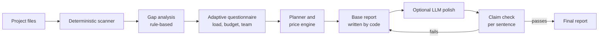

# InfraLoop

**Plan your infrastructure from your project: what's missing, what it costs per month, what to run it on, and how to scale.**

Live: https://infraloop.space (free to try)

InfraLoop scans a project (a repository or uploaded files), asks a few questions about expected load, and produces a report:

- what is missing for production
- a monthly cost estimate for the load you expect
- which infrastructure fits
- how to scale, and what to do first

Your source code and secrets are never sent to an LLM.

## How it works

1. **Scanner**: reads project signals (languages, containers, CI, data stores, config) with plain code.
2. **Gap analysis**: rule-based findings, no LLM.
3. **Questionnaire**: asks only what the scan couldn't answer.
4. **Planner and price engine**: deterministic cost and sizing math.
5. **Base report**: written by code, so it is repeatable.
6. **LLM polish (optional)**: improves wording only. Every sentence is checked against the findings. If a sentence fails, the code-written text is used.

## Deployment

- Caddy is the only service facing the internet.
- The app and the LLM gateway listen on localhost only.
- Per-visitor rate limits protect the public instance.

## Questions and answers

### What problem does it solve?
Before going live, small teams usually don't know what their project is missing (CI/CD, monitoring, backups, secrets handling), what it will cost per month, or what to run it on. Answers are scattered across blog posts and cloud pricing pages. InfraLoop turns one scan and a few questions into one clear plan.

### How is this different from asking an LLM?
A chatbot guesses from whatever you paste in. InfraLoop does the opposite:
- The scan, the gap analysis and the cost math are **plain code**, so the same project gives the same result.
- An LLM is **optional** and only polishes wording. Every sentence it writes is checked against the findings, and if a sentence fails the check, the code-written text is used.
- Your **source code and secrets never go to the LLM**.

### Who is it for?
Developers, students and small teams planning to deploy a project who want a realistic plan and a monthly cost before they spend money.

### Why is there no code in this repository?
The source is private for now, because the tool is still changing quickly. This repository documents what it does and how it is built, and the live tool is free to use, so you can judge it yourself.

### Is it really free?
Yes. InfraLoop is free and will stay free. The public instance runs on a small server, so there are per-visitor hourly limits.

### What do I see on the live site, and is it finished?
What you see at https://infraloop.space is roughly **30% of the planned work**. It already scans, asks questions and produces a plan with costs, and more is coming soon.

### What is planned next?
- Separate **required** and **optional** findings, so small projects aren't told they have gaps they don't need to fix
- A **free or near-free option** for tiny projects
- **Provider-neutral** recommendations, not tied to one cloud
- **Structured JSON export** (findings, costs, gaps) so reports can be compared in CI
- Better scaling advice and a clearer "what to do first" list

### How can I give feedback?
Open an issue in this repository, or try the tool and tell me where the plan or cost estimate looks wrong. That is the most useful feedback.

## Stack

Python, FastAPI, LangGraph, Podman, Caddy, Cloudflare DNS, Oracle Cloud. 177 automated tests.

Built by Dhruvil Satani.
