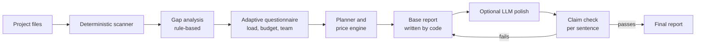
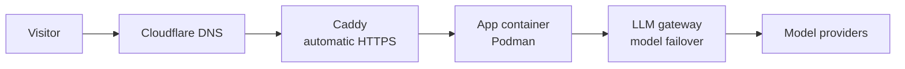

# InfraLoop

**Plan your infrastructure from your project: what's missing, what it costs per month, what to run it on, and how to scale.**

Live: https://infraloop.space (free to try)

InfraLoop scans a project (a repository or uploaded files), asks a few questions about expected load, and produces a report:

- what is missing for production
- a monthly cost estimate for the load you expect
- which infrastructure fits
- how to scale, and what to do first

Your source code and secrets are never sent to an LLM.

## How it works

1. **Scanner**: reads project signals (languages, containers, CI, data stores, config) with plain code.
2. **Gap analysis**: rule-based findings, no LLM.
3. **Questionnaire**: asks only what the scan couldn't answer.
4. **Planner and price engine**: deterministic cost and sizing math.
5. **Base report**: written by code, so it is repeatable.
6. **LLM polish (optional)**: improves wording only. Every sentence is checked against the findings. If a sentence fails, the code-written text is used.

## Deployment

- Caddy is the only service facing the internet.
- The app and the LLM gateway listen on localhost only.
- Per-visitor rate limits protect the public instance.

## Stack

Python, FastAPI, LangGraph, Podman, Caddy, Cloudflare DNS, Oracle Cloud. 177 automated tests.

## Status

Source is private for now. Feedback is welcome: open an issue or contact me.

Built by Dhruvil Satani.
